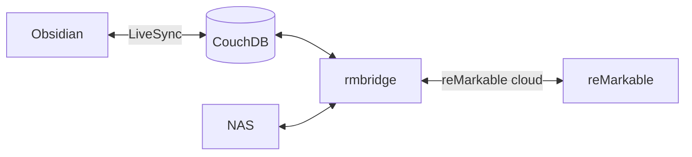

# rmbridge

> [!NOTE]
> Vibe-coded slop for now but i need the app to just work.

A small self-hosted web app that moves documents between your **NAS**, your
**reMarkable** (Paper Pro / rM2 / Move) and, if you want, your **Obsidian vault**.

- 📂 **NAS ⇄ reMarkable**: two panes, tick files, press **Send to reMarkable →**
  or **← Save to NAS**. Your handwriting comes back as PDFs.
- 📚 **Auto-send NAS folders**: e.g. every new book in your NAS `Books/`
  folder lands in `/Books` on the tablet (`NAS_SYNC`, see [below](#auto-send-nas-folders)).
- 🖱️ **Drag & drop** PDFs/EPUBs from your desktop onto the tablet.
- 📝 **Obsidian sync**: the vault folder `reMarkable/` and the tablet folder
  `/Obsidian` are kept the same, both ways. Notes show up on the tablet as PDFs,
  and whatever you write on them comes back to the vault.



## Setup

You need a machine with Docker that stays on (e.g. your NAS) and a reMarkable
account with cloud sync turned on.

**1. Configure**

Copy this project to the machine, then inside its folder:

```bash
cp .env.example .env
mkdir -p data
```

Open `.env` and fill in at least:

- `NAS_SHARE`: the folder with your PDFs/EPUBs
- `APP_PASSWORD`: the password for the web page
- `LIVESYNC_*`: only for the Obsidian sync, see [step 4](#4-optional-obsidian-sync)

**2. Connect your reMarkable account (once)**

```bash
docker compose build
docker compose run --rm -it rmbridge rmapi
```

Get a code at <https://my.remarkable.com/device/browser/connect>, paste it,
then type `exit`.

**3. Start it**

```bash
docker compose up -d
```

Open `http://<your-nas>:8484`. 🎉

> [!TIP]
> After changing `.env`, run `docker compose up -d` again to apply it.

**4. (Optional) Obsidian sync**

In Obsidian, open **Settings → Self-hosted LiveSync → Remote Configuration** and
copy the values into `.env`:

| In the plugin               | In `.env`                                  |
| --------------------------- | ------------------------------------------ |
| URI                         | `LIVESYNC_URL`                             |
| Database name               | `LIVESYNC_DATABASE`                        |
| Username / Password         | `LIVESYNC_USERNAME` / `LIVESYNC_PASSWORD`  |
| E2EE passphrase (if on)     | `LIVESYNC_PASSPHRASE`                      |

Create a folder called `reMarkable` in your vault and run `docker compose up -d`.
The footer of the web page turns green when LiveSync is connected.

| You do this                                   | You get                                     |
| --------------------------------------------- | ------------------------------------------- |
| Put `X.md` / a PDF in `reMarkable/`           | It shows up in `/Obsidian` on the tablet     |
| Write on `X` on the tablet                    | `X.pdf` with your ink appears next to `X.md` |
| Annotate a PDF from the vault                 | The PDF in the vault gets your annotations  |
| Make a notebook in `/Obsidian` on the tablet  | `Name.pdf` appears in the vault             |

> [!IMPORTANT]
> Handwriting comes back as a PDF, not as text, and deletes aren't synced.
> Details and troubleshooting: [docs/obsidian-livesync.md](docs/obsidian-livesync.md).

> [!WARNING]
> If `CouchDB` runs on the same machine, don't use `localhost` in `LIVESYNC_URL`.
> Use the machine's LAN IP, because rmbridge runs inside a container.

## Auto-send NAS folders

Set `NAS_SYNC` in `.env` to folders inside `NAS_SHARE` that should end up on
the tablet, then `docker compose up -d`:

```bash
NAS_SYNC=Books                        # NAS_SHARE/Books     -> /Books
NAS_SYNC=Books:/Library, Papers/ML    # NAS_SHARE/Books     -> /Library
                                      # NAS_SHARE/Papers/ML -> /ML
```

Every `SYNC_INTERVAL` seconds (or with **Sync NAS folders now** in the footer)
new PDFs/EPUBs are uploaded, subfolders included. It only goes one way and each
file is sent once: your annotations are never overwritten, a book you delete on
the tablet stays deleted, and books already on the tablet under the same name
aren't sent twice.

## Troubleshooting

| Problem                                   | Fix                                                                 |
| ----------------------------------------- | ------------------------------------------------------------------- |
| `Permission denied: '/data/state'`        | `sudo chown -R 1000:1000 data` (or set `PUID`/`PGID` in `.env`)      |
| `CouchDB not ready: HTTP 401`             | Wrong LiveSync username/password                                    |
| `CouchDB not ready: HTTP 404`             | Wrong `LIVESYNC_URL` or `LIVESYNC_DATABASE`                         |
| Nothing arrives on the tablet             | Switch the header to **Cloud**, then press **Sync Obsidian vault now** |

Logs: `docker compose logs -f rmbridge`

<details>
<summary><b>USB cable instead of the cloud</b></summary>

Turn on *Settings → Storage → USB web interface* on the tablet, plug it into the
machine running rmbridge and pick **USB** in the header (or set `RM_BACKEND=usb`).
No account needed, but it can't create folders or overwrite files, so use
**Cloud** for the Obsidian sync.

</details>

<details>
<summary><b>Run without Docker</b></summary>

```bash
# rmapi (needs Go), then log in once and type `exit`
git clone https://github.com/ddvk/rmapi /tmp/rmapi && (cd /tmp/rmapi && go build -o ~/.local/bin/rmapi .)
rmapi

# only for the Obsidian sync (needs Deno)
git clone https://github.com/vrtmrz/livesync-bridge ~/.local/share/livesync-bridge
(cd ~/.local/share/livesync-bridge && deno install --frozen)
echo "LIVESYNC_BRIDGE_DIR=$HOME/.local/share/livesync-bridge" >> .env

uv run rmbridge   # → http://localhost:8484
```

Rendering notes needs Pango (`pango` on Arch, `libpango-1.0-0` on Debian/Ubuntu).

</details>

<details>
<summary><b>All settings</b></summary>

Everything is set in `.env`, see [`.env.example`](.env.example).

| Variable                        | Default             | Meaning                                                  |
| ------------------------------- | ------------------- | -------------------------------------------------------- |
| `NAS_SHARE`                     | `./data/nas`        | Folder shown in the NAS pane                             |
| `NAS_SYNC`                      | –                   | NAS folders auto-sent to the tablet, e.g. `Books:/Books`  |
| `RM_BACKEND`                    | `cloud`             | `cloud` or `usb`                                         |
| `RM_USB_URL`                    | `http://10.11.99.1` | USB web interface address                                |
| `RM_VAULT_FOLDER`               | `/Obsidian`         | Tablet folder mirrored with the vault                    |
| `LIVESYNC_URL`                  | –                   | CouchDB URI from the plugin; turns on the Obsidian sync  |
| `LIVESYNC_DATABASE` / `_USERNAME` / `_PASSWORD` | –   | Same as in the plugin                                    |
| `LIVESYNC_PASSPHRASE`           | –                   | E2EE passphrase (empty if E2EE is off)                   |
| `LIVESYNC_OBFUSCATE_PASSPHRASE` | –                   | Path obfuscation passphrase (empty if off)               |
| `LIVESYNC_ID_KEY`               | –                   | `sls-id-v1:…` recovery code (newer E2EE vaults)          |
| `LIVESYNC_VAULT_FOLDER`         | `reMarkable`        | Vault folder mirrored with the tablet                    |
| `SYNC_INTERVAL`                 | `120`               | Seconds between tablet/NAS syncs (`0` = button only)     |
| `APP_PASSWORD`                  | –                   | Password for the web page (any username)                 |
| `PORT`                          | `8484`              | Web page port                                            |
| `PUID` / `PGID`                 | `1000`              | User the container runs as                               |
| `DATA_DIR`                      | `./data/state`      | Login, sync state and the vault copy                     |
| `VAULT_DIR`                     | –                   | Without LiveSync: mirror a local folder instead          |

</details>

<details>
<summary><b>Development</b></summary>

```bash
uv sync
uv run pytest   # fake rmapi, mocked USB interface and a fake livesync-bridge
```

</details>
